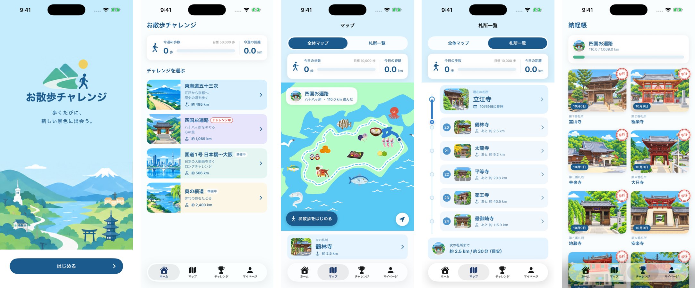

# お散歩チャレンジ

**歩くたびに、新しい景色に出会う。**
いつもの散歩で歩いた距離が、イラストの地図の上で「東海道五十三次」や「四国お遍路」の旅になる iPhone アプリのプロトタイプです。



## どんなアプリか

- **どこを歩いてもOK**：近所の散歩でも、公園でも。「お散歩をはじめる」〜「お散歩を終了する」の間に歩いた距離だけが、旅に加わります。GPS は使わず、iPhone の歩数計（Core Motion）で測ります。
- **2つのコース**
  - 東海道五十三次：江戸・日本橋 → 京都・三条大橋（約 495.5 km、55 地点）
  - 四国お遍路：1番 霊山寺 → 88番 大窪寺（約 1,069 km、88 か所）
- **歩いた道が色づく地図**：イラストの日本地図の上で、歩いた区間が青く塗られていきます。指で拡大・移動できます。
- **到着の演出とスタンプ**：宿場・札所に着くと、紙吹雪とスタンプの演出。宿場帳・納経帳にスタンプが集まります。
- **宿場・札所の解説**：すべての地点にオリジナルのイラストと解説（Wikipedia を参考に作成）。
- **記録**：今日・今週の歩数と距離、これまでの合計、地球何周分歩いたか。
- **アカウント不要**：記録はすべて iPhone の中だけに保存し、外部へは送りません。

## 作り方

アプリ開発は初めての作者が、Claude（Anthropic の AI）と会話しながら作っています（いわゆるバイブコーディング）。

- 企画・画面デザイン・イラスト・地図：作者（Adobe Illustrator / Photoshop）
- コード：Claude Code と一緒に作成
- 実機（iPhone 13 Pro Max）で実際に散歩をしてテストしながら改良

## 技術

| | |
|---|---|
| 言語・UI | Swift / SwiftUI（iOS 17 以降） |
| 歩数・距離 | Core Motion（お散歩中の計測）、HealthKit（今週の歩数の表示・読み取りのみ） |
| 保存 | UserDefaults（端末内のみ） |
| 地図 | Illustrator で描いた地図とパスを座標に変換し、SwiftUI の Canvas で描画 |

## ファイル構成

```
OsanpoChallenge/
├── Models/      コースのデータ（宿場・札所・距離・地図上の道）、解説、進み具合の計算
├── Services/    お散歩の記録（Core Motion）、HealthKit、コースごとのチャレンジ記録
└── Views/       各画面（ホーム、コース詳細、マップ、一覧、宿場帳、到着の演出、マイページ）
tools/           イラストの取り込みなどの補助スクリプト
```

## このリポジトリについて

- この公開版には、**コードとアプリアイコンだけ**を入れています。宿場・札所のイラスト、地図、コース画像は含まれていないため、ビルドするとそれらの部分は空白（淡い色）で表示されます。
- 実機で動かす場合は、Xcode の「Signing & Capabilities」で、ご自分の Team を選んでください（HealthKit を使用）。
- © 2026 otenkisaiko. All rights reserved.（コード・デザインの無断転載はご遠慮ください）
